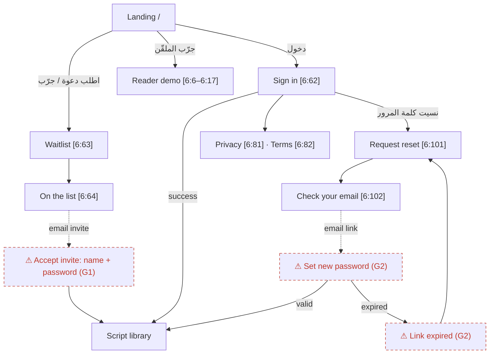
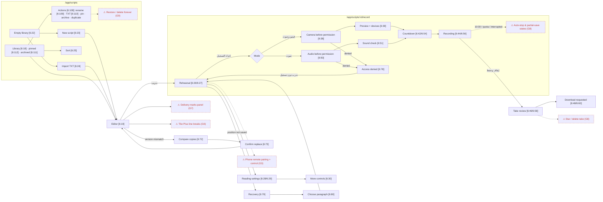
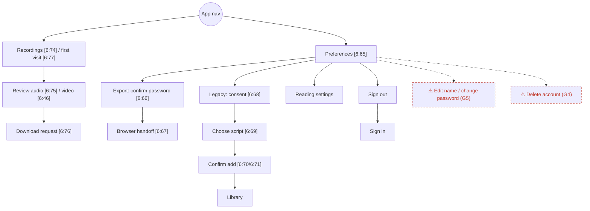

# App Flow

Dashed nodes with ⚠ are **gaps** (no Figma screen yet — see [gaps.md](./gaps.md)).
Numbers in brackets are Figma node ids on page `02 · Prototype`.

## 1. Access & auth

## 2. Core loop: write → rehearse → record → keep

## 3. Recordings & settings

